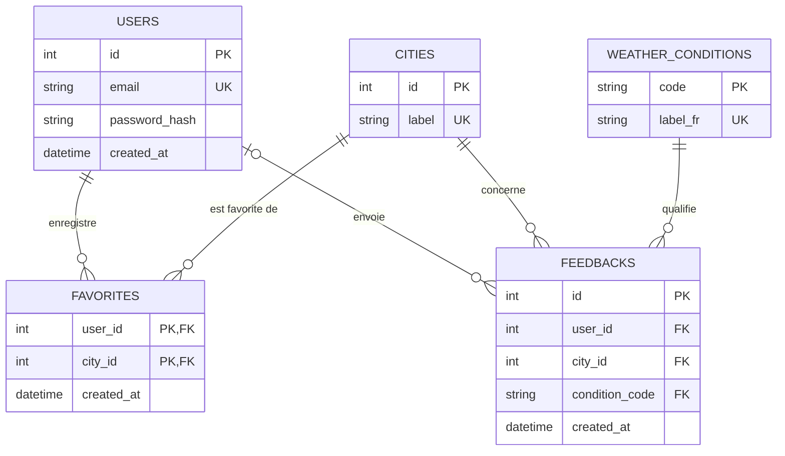

# MeteoAPP — Conception de la base de données (CP-003150)

## 1. Besoin à couvrir

| Fonctionnalité de l'appli | Donnée à conserver |
|---|---|
| Se connecter à son compte | Email, mot de passe (sous forme d'empreinte) |
| Enregistrer une ville en favoris, sans doublon | Lien utilisateur ↔ ville |
| Écran Feedback : indiquer la condition météo observée | Ville, condition choisie, date, auteur |

Jusqu'ici ces données restaient dans AsyncStorage, sur le téléphone : impossible de les
retrouver sur un autre appareil, et aucun retour utilisateur n'était réellement collecté
(limite déjà annoncée dans le rapport : « feedback non centralisé »).

## 2. Dictionnaire de données

| Table | Colonne | Type | Contraintes |
|---|---|---|---|
| users | id | SERIAL | PK |
| | email | VARCHAR(255) | NOT NULL, UNIQUE |
| | password_hash | VARCHAR(255) | NOT NULL (hash bcrypt, jamais le mot de passe) |
| | created_at | TIMESTAMPTZ | NOT NULL, défaut now() |
| cities | id | SERIAL | PK |
| | label | VARCHAR(255) | NOT NULL, UNIQUE |
| weather_conditions | code | VARCHAR(3) | PK (code d'icône OpenWeatherMap) |
| | label_fr | VARCHAR(60) | NOT NULL, UNIQUE |
| favorites | user_id | INTEGER | PK composée, FK → users, ON DELETE CASCADE |
| | city_id | INTEGER | PK composée, FK → cities, ON DELETE CASCADE |
| | created_at | TIMESTAMPTZ | NOT NULL, défaut now() |
| feedbacks | id | SERIAL | PK |
| | user_id | INTEGER | FK → users, ON DELETE SET NULL (nullable) |
| | city_id | INTEGER | NOT NULL, FK → cities |
| | condition_code | VARCHAR(3) | NOT NULL, FK → weather_conditions |
| | created_at | TIMESTAMPTZ | NOT NULL, défaut now() |

## 3. Modèle conceptuel (MCD)



Cardinalités : un utilisateur a 0 à N favoris ; une ville peut être favorite de 0 à N
utilisateurs (association N-N, d'où la table `favorites`) ; un feedback concerne exactement
une ville et une condition, et a 0 ou 1 auteur.

## 4. Modèle logique (MLD)

- users (**id**, email, password_hash, created_at)
- cities (**id**, label)
- weather_conditions (**code**, label_fr)
- favorites (**#user_id**, **#city_id**, created_at)
- feedbacks (**id**, #user_id, #city_id, #condition_code, created_at)

(**gras** = clé primaire, # = clé étrangère)

## 5. Choix de conception et justifications

- **3e forme normale** : chaque information n'est stockée qu'une fois. Le libellé d'une
  ville est dans `cities`, le libellé d'une condition dans `weather_conditions` : aucun
  texte répété dans `favorites` ni `feedbacks`, donc pas d'incohérence possible.
- **Table de référence `weather_conditions`** plutôt qu'un texte libre : la base refuse une
  condition inconnue (clé étrangère), ce qui sécurise les données.
- **Doublons de favoris** impossibles au niveau de la base (clé primaire composée), en plus
  du contrôle côté appli : la règle ne dépend plus d'un seul client.
- **Sécurité** : mot de passe stocké sous forme de hash ; les requêtes de l'API seront
  paramétrées (pas de concaténation de SQL, protection contre l'injection SQL).
- **RGPD** : la suppression d'un compte supprime ses favoris (CASCADE) et rend ses feedbacks
  anonymes (SET NULL) : les données personnelles disparaissent, les statistiques restent.
- **Index** sur `feedbacks (city_id, created_at)` et `favorites (user_id)` : ce sont les
  colonnes utilisées par les requêtes les plus fréquentes (stats par ville, favoris d'un user).
- **Vue `v_feedback_stats`** : nombre de retours par ville et par condition, prête pour
  l'écran Feedback.

## 6. Mise en place

```bash
createdb meteoapp
psql -d meteoapp -f backend/db/schema.sql
psql -d meteoapp -f backend/db/seed.sql
```

## 7. Partie NoSQL : historique de recherches (MongoDB)

### Pourquoi deux types de bases ?

| | PostgreSQL (SQL) | MongoDB (NoSQL) |
|---|---|---|
| Données | comptes, favoris, feedbacks | historique de recherches |
| Nature | données de référence, liées entre elles | données d'activité, indépendantes |
| Contraintes | intégrité forte (clés étrangères, unicité) | aucune relation, structure souple |
| Cycle de vie | conservées tant que le compte existe | doivent disparaître automatiquement |

Un favori ou un compte doit être cohérent à tout prix (un favori ne peut pas pointer
vers une ville inexistante) : c'est le rôle d'une base relationnelle. L'historique de
recherches est au contraire une simple trace d'activité, écrite souvent et sans lien
complexe : un document par recherche suffit, sans table de jointure.

### Modèle de la collection `search_history`

```json
{ "userId": 12, "city": "Drancy", "searchedAt": "2026-11-06T20:54:08Z", "count": 3 }
```

- Un seul document par couple (`userId`, `city`) : index **unique composé**. Une nouvelle
  recherche met à jour la date et incrémente `count` (opération *upsert*) : pas de doublon.
- Index `{ userId: 1, searchedAt: -1 }` : lecture rapide des dernières recherches.
- Index **TTL** sur `searchedAt` (90 jours par défaut, réglable avec `HISTORY_TTL_DAYS`) :
  MongoDB supprime lui-même les documents périmés. C'est la durée de conservation limitée
  exigée pour des données personnelles (RGPD).
- Route `DELETE /api/history` : l'utilisateur peut effacer son historique (droit à l'effacement).

### Sécurité

- **Injection NoSQL** : un client malveillant pourrait envoyer `{ "city": { "$ne": null } }`
  pour fausser une requête. La valeur est donc validée (`cleanLabel` n'accepte que du texte)
  et l'identifiant utilisateur vient du jeton signé, jamais du corps de la requête. Un test
  automatisé vérifie le rejet (400).
- Le `userId` stocké est l'identifiant PostgreSQL : le lien entre les deux bases est logique,
  pas physique (MongoDB n'a pas de clé étrangère). Conséquence à gérer : à la suppression
  d'un compte, l'historique doit aussi être effacé côté MongoDB.

### Composants d'accès aux données

| Base | Composant | Fichier |
|---|---|---|
| PostgreSQL | repositories users, cities, favorites, feedbacks | `src/repositories/*Repository.js` |
| MongoDB | repository d'historique | `src/repositories/historyRepository.js` |
| MongoDB | connexion partagée | `src/db/mongo.js` |

## 8. Suite prévue

- Plan de tests documenté, conteneurisation (Docker), pipeline CI/CD et documentation de
  déploiement (CP-003151).
- Vérification en deux étapes par SMS (ajout d'une colonne `phone_number` à `users`).
